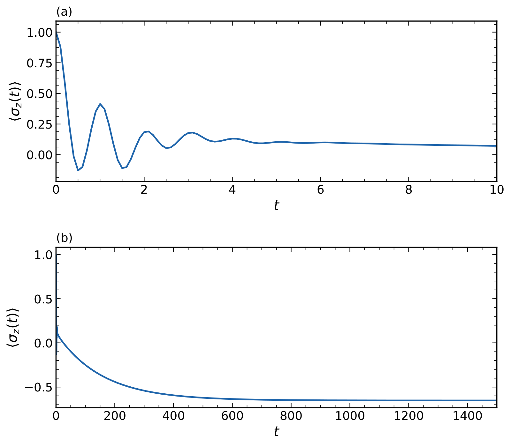
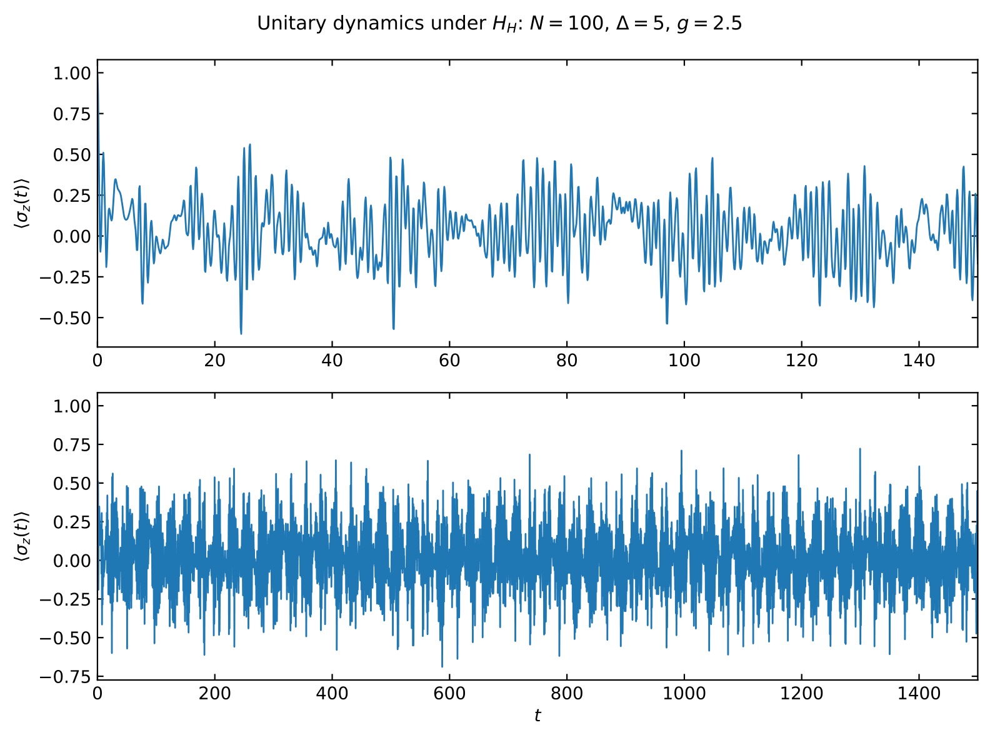
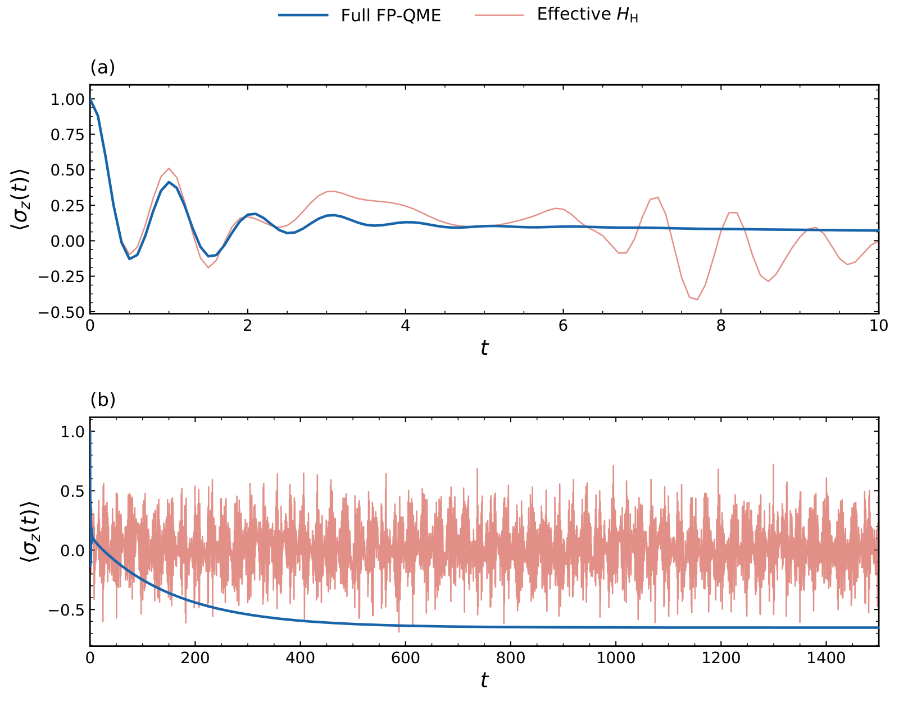
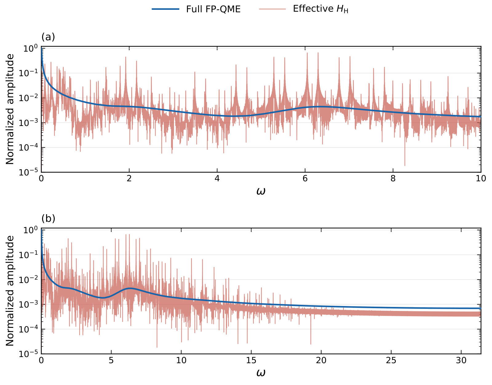
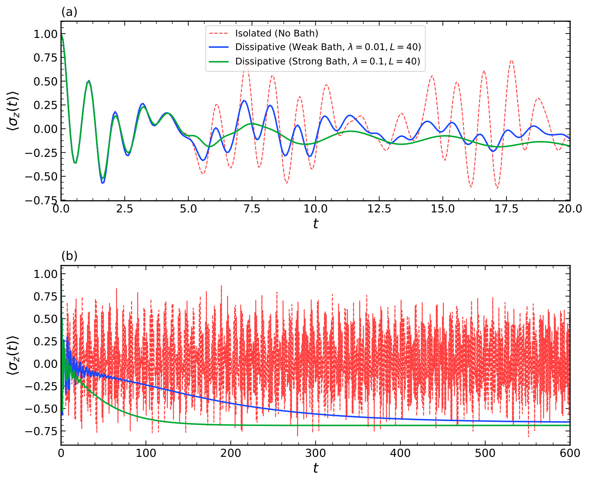
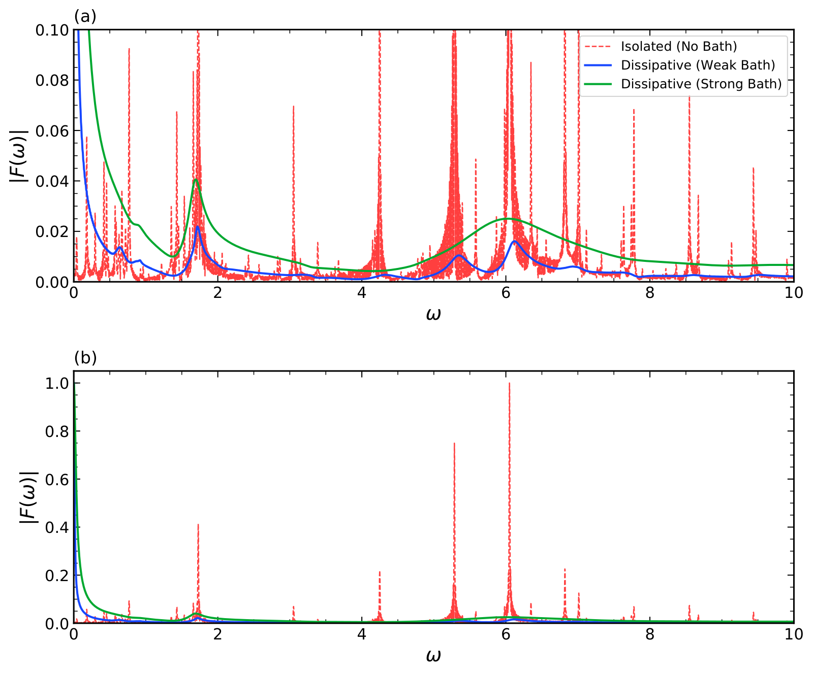

# AQRM dynamics and Fourier-domain comparisons

This folder contains six supplementary figures for the asymmetric quantum Rabi model (AQRM), organized by bath spectral density and propagation method. Each figure is provided as an original PDF and a PNG preview rendered from that PDF.

| Set | Bath and method | Figures |
| --- | --- | --- |
| [BO / FP-QME](#1-brownian-oscillator-bath-full-fp-qme-and-effective-h_h) | Brownian-oscillator (BO) bath; full FP-QME propagation and unitary propagation under the effective Hermitian Hamiltonian H_H | 01-04 |
| [Drude / HQME](#2-drude-bath-hqme) | Drude bath; HQME calculations with an isolated reference | 05-06 |

The BO and Drude sets use different bath models and system parameters. The Drude results are a separate supplementary calculation, rather than a same-parameter benchmark of the BO FP-QME.

## Figure index

| No. | PDF | Content and displayed ranges |
| --- | --- | --- |
| 01 | [BO_full_FPQME_time.pdf](BO_FPQME/01_BO_full_FPQME_time.pdf) | Full FP-QME time evolution. Upper: t = 0-10; lower: t = 0-1500. |
| 02 | [BO_effective_HH_time.pdf](BO_FPQME/02_BO_effective_HH_time.pdf) | Unitary effective-H_H time evolution. Upper: t = 0-150; lower: t = 0-1500. |
| 03 | [BO_FPQME_vs_HH_time.pdf](BO_FPQME/03_BO_FPQME_vs_HH_time.pdf) | Time-domain overlay of full FP-QME and effective H_H. Upper: t = 0-10; lower: t = 0-1500. |
| 04 | [BO_FPQME_vs_HH_frequency_log.pdf](BO_FPQME/04_BO_FPQME_vs_HH_frequency_log.pdf) | Fourier-amplitude overlay with a logarithmic ordinate. Upper: angular frequency 0-10; lower: the shared nonnegative frequency range, approximately 0-31.42. |
| 05 | [Drude_HQME_time.pdf](Drude_HQME/05_Drude_HQME_time.pdf) | Time-domain overlay for lambda = 0, 0.01, 0.1. Upper: t = 0-20; lower: t = 0-600. |
| 06 | [Drude_HQME_frequency.pdf](Drude_HQME/06_Drude_HQME_frequency.pdf) | Fourier-amplitude overlay for the same three Drude cases. Both panels display angular frequency 0-10; the upper panel uses the smaller ordinate range 0-0.10, and the lower panel shows 0-1. |

The panel ranges above describe the supplied PDFs. In particular, Figure 06 enlarges the vertical scale; its lower panel is not the entire available FFT frequency range.

## 1. Brownian-oscillator bath: full FP-QME and effective H_H

The measured observable is z(t) = <sigma_z(t)>.

- **Full FP-QME:** propagation under the full FP-QME generator at the stated oscillator cutoff, retaining the terms of the supplied FP-QME implementation, including the delta2 correction.
- **Effective H_H:** unitary evolution generated by the effective Hermitian Hamiltonian extracted in the associated manuscript.

Here, "full" refers to the retained FP-QME generator in the finite spin-oscillator space. It does not mean an untruncated oscillator or the full bath Hilbert space. The figures show time traces and their Fourier transforms, rather than the eigenvalue spectrum of the Liouvillian.

### Parameters

The effective bath parameters
$\bar{\Omega}$, $\bar{\zeta}$, $\delta_0$, $\delta_1$, and $\delta_2$
were obtained by least-square fitting of the Brownian-oscillator
bath correlation function with input damping parameter
$\zeta_{\mathrm{input}}=1.0$ and inverse temperature $\beta=1.0$,
using the fitting procedure described in the manuscript.

The input value $\zeta_{\mathrm{input}}=1.0$ is distinct from the
fitted value $\bar{\zeta}=0.9987979339035183$.
Both the full FP-QME and effective-$H_{\mathrm H}$ calculations
use this same fitted parameter set.

| Script parameter | Value |
| --- | --- |
| `zeta_input` | `1.0` |
| `Delta` | `5.0` |
| `epsilon` | `2.0 * 0.8670217872367088 = 1.7340435744734175` |
| `g` | `2.5` |
| `beta` | `1.0` |
| `barOmega` | `1.000562895442171` |
| `bar_zeta` | `0.9987979339035183` |
| `delta0` | `0.08029553992562366` |
| `delta1` | `0.07681533814123918` |
| `delta2` | `-0.0006022080159356902` |
| `Ncut` | `100` |
| `include_E0` | `True` |
| Saved time interval | `0-1500` |
| Number of saved time points | `15001` |
| Time step | `0.1` |

`Ncut = 100` retains oscillator Fock states n = 0,...,99. Including the two-level system gives a Hilbert-space dimension of 200 and a Liouville-space dimension of 40000. The input damping parameter `zeta_input` and fitted `bar_zeta` are listed separately.

### Time and frequency comparisons

Figure 03 overlays the original expectation values, preserving their offsets and oscillation amplitudes.

For Figure 04, the comparison workflow subtracts a separate baseline from each time trace before Fourier transformation:

- Full FP-QME: the mean over the final 20% of the saved trajectory, approximately `-0.6519573277184113`.
- Effective H_H: the mean over the complete saved trajectory, approximately `0.013471718993478751`.

The effective-H_H baseline is a finite-time average, not a dissipative equilibrium value. The full FP-QME tail mean is an estimate of the asymptotic observable.

The Fourier amplitude is computed as

```text
F(omega) = dt * sum_n [z(t_n) - baseline] * exp[-i * omega * (t_n - t_start)]
omega = 2*pi*f
```

The displayed magnitude is |F(omega)|. The supplied comparison workflow uses the shared interval 0-1500, no additional exponential damping (`ETA = 0`), and zero-padding to smooth the displayed frequency grid. Both spectra are divided by the same maximum amplitude over the shared frequency range. This common normalization preserves their relative amplitudes. Figure 04 uses a logarithmic vertical axis.

The comparison documents similarities and differences in the observable's frequency content. It does not identify unitary H_H evolution with the complete dissipative dynamics. In particular, the two models have different long-time behavior. Peak correspondence should be assessed with finite-time and window effects in mind.

### Previews

**01 - Full FP-QME time evolution**



**02 - Effective H_H unitary time evolution**



**03 - Time-domain comparison**



**04 - Fourier-domain comparison**



## 2. Drude bath: HQME

This set compares an isolated AQRM reference (`lambda = 0`) with two Drude-bath calculations (`lambda = 0.01` and `0.1`). The dissipative calculations use the HQME method based on the improved semiclassical treatment of Drude dissipation in the reference below.


### Bath spectral density

The Drude spectral density follows the convention of Xu et al.
[J. Chem. Phys. 131, 214111 (2009)]:

<p align="center">
<strong>J<sub>D</sub>(ω) = 2λγω / (ω<sup>2</sup> + γ<sup>2</sup>), &nbsp; ω &gt; 0.</strong>
</p>

Here, λ is the bath reorganization energy and γ is the Drude decay rate.
The calculations use γ = 1.0 and λ = 0, 0.01, 0.1.
The case λ = 0 is the isolated reference.

### Parameters

| Script parameter | Value / meaning |
| --- | --- |
| `w` | `1.0` |
| `g` | `1.8` |
| `Delta` | `5.0` |
| `eps` | `2.0` |
| `N` | `100`; oscillator Fock cutoff before low-energy projection |
| `nsys` | `50`; number of retained lowest AQRM eigenstates |
| `temp` | `1.0`; temperature parameter in the implementation |
| `gamma` | `1.0`; Drude bath decay parameter |
| `lamb` / lambda | `0`, `0.01`, `0.1` |
| `L` | `40`; hierarchy cutoff for the dissipative cases |
| `t_max` | `600` |
| `t_eval` | `np.linspace(0, 600, 8192)` |
| Sampling interval | `600 / 8191`, approximately `0.07325112928824319` |

`N`, `nsys`, and `L` refer to different truncations. The isolated reference has no bath and does not require a dissipative hierarchy.

The figure legends use "Weak Bath" for lambda = 0.01 and "Strong Bath" for lambda = 0.1 as labels distinguishing the two plotted bath strengths.

### Frequency-domain figure

Figure 06 shows Fourier amplitudes of the three time traces. In the plotting workflow, the isolated trace is centered using a time-average baseline, while the dissipative traces are centered using estimated late-time baselines.

The supplied PDF has an ordinate labeled |F(omega)| with a maximum displayed value of 1 in the lower panel. The exact normalization choice is not recorded in the PDF. Absolute peak-height comparisons should therefore be made using the generating script and its normalization setting, rather than inferred from this figure alone. Figure 04 explicitly uses common normalization, as described above.

These are Fourier transforms of one-time expectation values; they are not calculated absorption or emission spectra from two-time correlation functions.

### Method reference

Rui-Xue Xu, Bao-Ling Tian, Jian Xu, Qiang Shi, and YiJing Yan, "Hierarchical quantum master equation with semiclassical Drude dissipation," *The Journal of Chemical Physics* **131**, 214111 (2009).

DOI: [10.1063/1.3268922](https://doi.org/10.1063/1.3268922).

### Previews

**05 - Drude-HQME time evolution**



**06 - Drude-HQME Fourier amplitudes**



## Files and reproducibility

This figure bundle contains six original PDFs and six corresponding PNG previews. The PDFs are unchanged apart from their filenames; the previews are rendered copies of the same figures.

Raw trajectories and calculation scripts are not included in this figure-only bundle. The BO source trajectories are named `dynamics.csv` and `HH_sigma_z_dynamics.csv`. To reproduce the figures, retain the source trajectories together with the generation and plotting scripts, run metadata, initial-state definitions, and frequency-processing settings.

The parameter values in this README describe the reported runs. They do not by themselves establish convergence with respect to oscillator cutoff, low-energy projection, or hierarchy depth.
