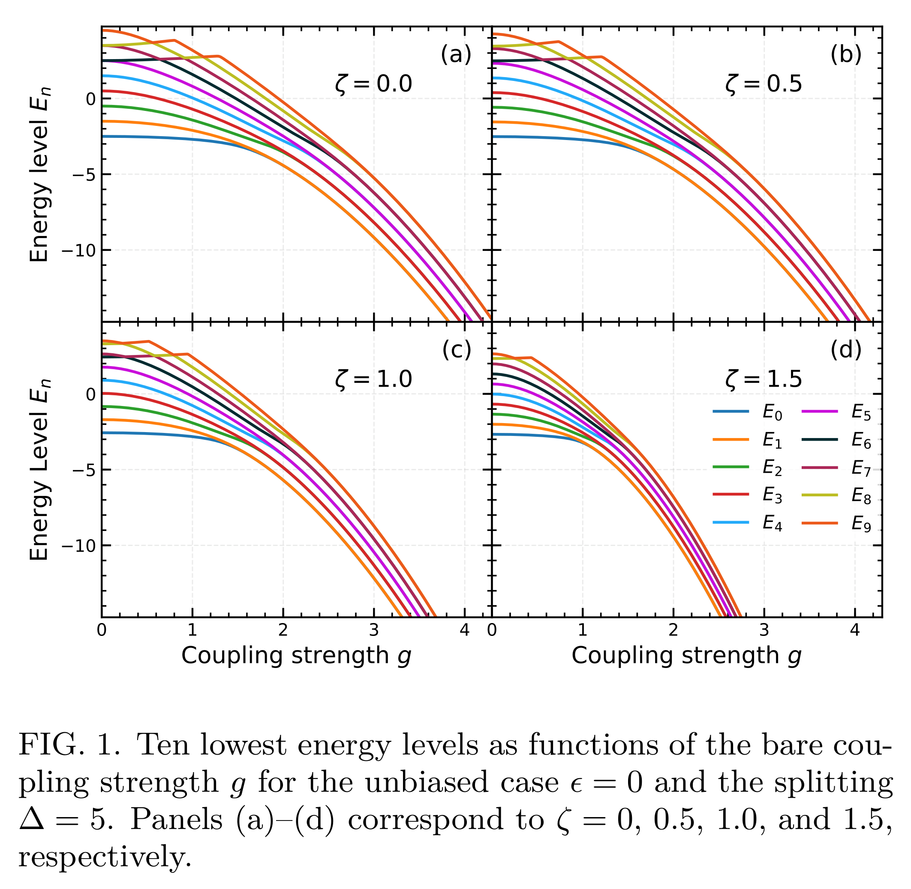
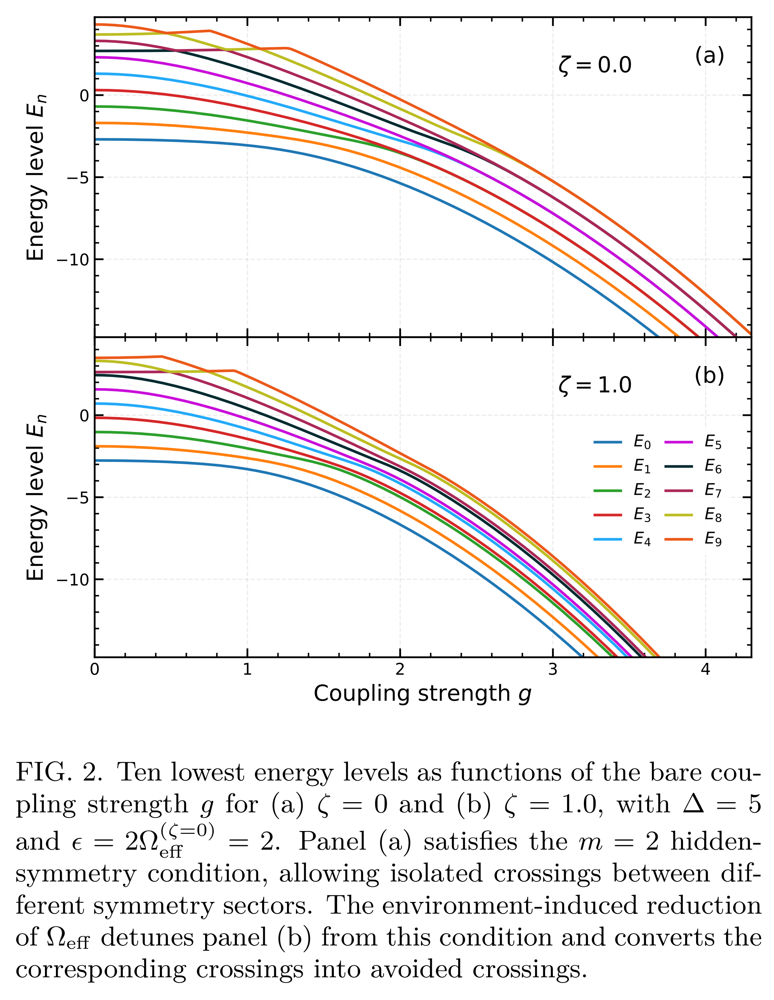
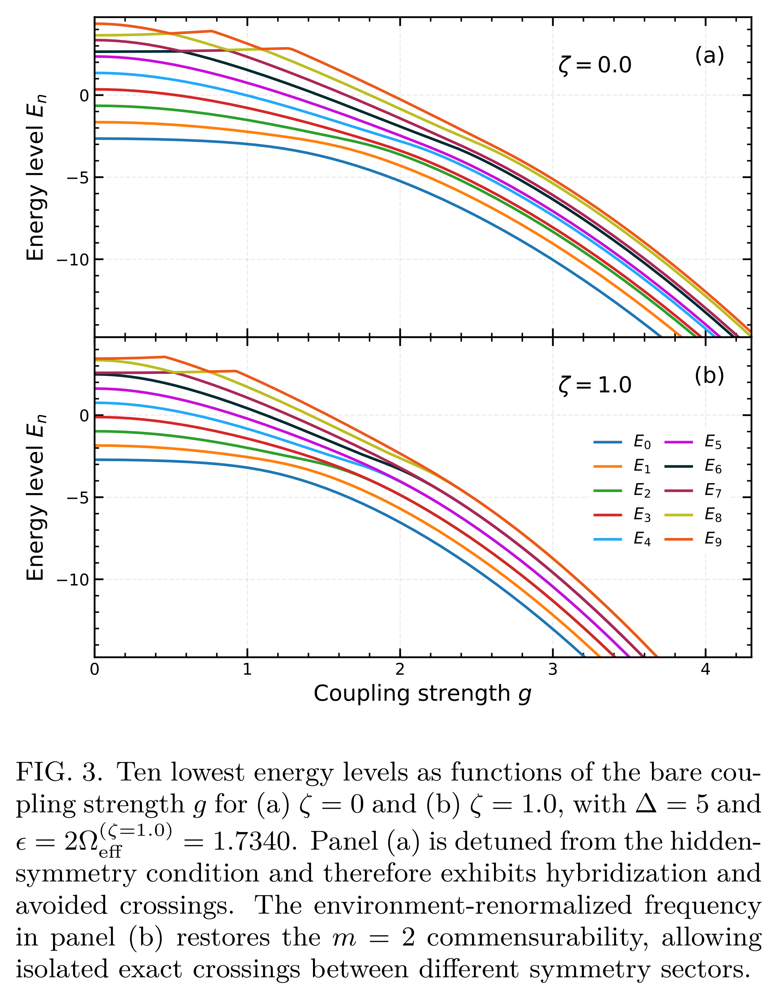

# Figures plotted in terms of ordered eigenvalues instantaneously

This folder contains three figures plotted in terms of ordered eigenvalues instantaneously, together with their captions. At each value of the bare coupling $g$, the eigenvalues are sorted in ascending order of energy. These figures provide a reference for comparing level crossings and avoided crossings with the symmetry-resolved spectra.

## Figure 1

## Figure 2

## Figure 3

